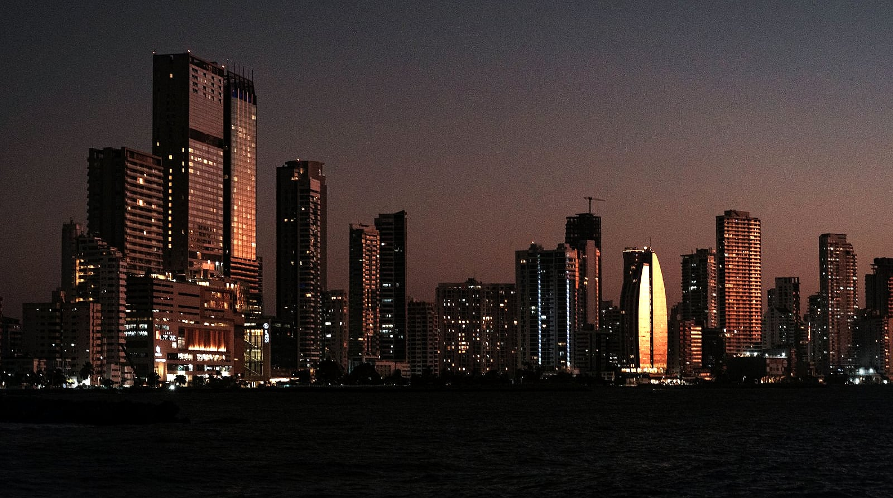

SLUG: citi-copa-connectmiles-emirates-business-class
CATEGORY: deals
TITLE: Citi Added Copa. The Same Emirates Seat, $800 Less
EXCERPT: Citi points now transfer to Copa ConnectMiles. Because Copa skips Emirates' surcharges and Citi pays Skywards 0.8 miles per point, the same Dubai seat costs far less.
META_TITLE: Citi Adds Copa: Emirates for 80,000 Points
META_DESCRIPTION: Citi ThankYou points now transfer to Copa ConnectMiles at 1:1. The same Emirates business seat costs 80,000 points and $40, not 120,000 and $835.
COVER_ALT: Split cover comparing two doors to one Emirates business seat: Skywards at 120,000 points, ConnectMiles at 80,000
---BODY---
**Citi ThankYou points now transfer to Copa ConnectMiles at 1:1, and on the route that matters most that makes the same Emirates business class seat to Dubai cost about 80,000 points and $40 instead of about 120,000 points and $835.** Copa does not collect Emirates' carrier surcharges, and Citi pays Emirates Skywards only 0.8 miles per point. The seat is identical. The door is not.

## Key takeaways

- Citi added Copa ConnectMiles on October 25, 2026, making it the first US credit card currency that reaches the program, at 1:1 on annual-fee cards and 1,000:700 on no-fee cards.
- ConnectMiles still publishes a fixed award chart, and it prices business class from the US and Canada to the Middle East at 80,000 miles one way, including on Emirates.
- Copa does not pass carrier-imposed surcharges through on partner awards, so the cash on that ticket is typically $10 to $50 rather than the roughly $835 Emirates Skywards collects.
- Citi transfers to Emirates Skywards at only 1:0.8, so the Skywards version of the same seat costs roughly 120,000 ThankYou points, about 40,000 more than the Copa version.

Nine outlets covered this news in the week it broke. Almost all of them printed the transfer ratios, reproduced Copa's award chart, mentioned in a single line that ConnectMiles books Emirates without fuel surcharges, and stopped there.

That line is the whole story. Citi points reach Emirates two different ways now, and the difference between them is roughly the price of a domestic round trip in cash plus 40,000 points. Here is the arithmetic nobody ran.

## What Citi actually added

On October 25, 2026, Copa ConnectMiles appeared on Citi's transfer partner page. Copa is a Star Alliance carrier based in Panama City, and until now its program was almost unreachable from the US: the only route in was Marriott Bonvoy at a poor 3:1. Citi is the first US card currency to partner with it directly.

The ratio depends on which card holds your points, and the gap is wide:

- **1:1** on the Citi Strata Elite, Citi Strata Premier, Citi Prestige and AT&T Access More.
- **1,000:700** on the Citi ThankYou Preferred, Citi Strata, Citi Double Cash, Citi Custom Cash, Citi ThankYou Mastercard and the older AT&T cards.

That second rate quietly destroys 30 percent of your balance, which is the same trap we flagged when [Citi added Japan Airlines](/blog/citi-thankyou-japan-airlines-transfer-partner) a month earlier. If your points sit on a Double Cash, price the award at 1,000:700 before you get excited about any number in this post. The minimum transfer is 1,000 points. Citi says transfers usually post within 24 hours but can take up to five business days, which matters more than it sounds and we come back to it below.

## The ratio nobody put next to the news

Here is the part the coverage skipped. Citi already transferred to Emirates Skywards, so a Citi cardholder could already book Emirates. But **Citi transfers to Skywards at 1:0.8**, not 1:1. Five ThankYou points become four Skywards miles. On the no-fee cards it is 1:0.56.

Emirates is one of a small number of Citi partners that takes a haircut on the way in, and it has been that way long enough that most people have stopped noticing. Put it next to the new Copa partnership and the comparison changes shape completely, because Copa takes no haircut at all.

## The same seat, two doors

Take a nonstop from the US to Dubai in Emirates business class, the seat both doors lead to.

Through **Emirates Skywards**, that award has priced at roughly 96,000 Skywards miles one way since the May 2026 devaluation, plus about $835 in taxes, fees and carrier charges. At Citi's 1:0.8 rate, those 96,000 miles cost you **120,000 ThankYou points**.

Through **Copa ConnectMiles**, Copa's published partner chart prices business class from the US and Canada to the Middle East at 80,000 miles one way, and the United Arab Emirates sits in that region. At 1:1, that is **80,000 ThankYou points**. Because Copa does not collect carrier surcharges on partner awards, the cash is typically $10 to $50. Published examples put Houston to Dubai and Los Angeles to Dubai at about $10 in taxes and fees.

So the same seat, on the same plane, on the same day, from the same Citi balance: 120,000 points and $835, or 80,000 points and about $40. Forty thousand points and roughly $800 apart.

On a no-fee Citi card the gap widens rather than closes. Skywards at 1:0.56 wants about 171,000 ThankYou points for that seat; Copa at 1,000:700 wants about 114,000.

## Why Copa is so cheap in cash

Nothing about Copa is generous here. It simply declines to collect a fee that Emirates would happily pass on.

A carrier-imposed surcharge is airline revenue added to an award ticket in cash, and whether you pay it depends on the program you book through rather than the flight you take. Emirates publishes its surcharge schedule and updates it monthly. Skywards passes it through on Emirates metal. ConnectMiles does not pass it through on any partner, which is why a Copa-booked award tends to land somewhere between the price of a sandwich and the price of a taxi.

This is the single highest-leverage idea in award travel, and it is worth understanding properly rather than memorizing one example. Our guide to [fuel surcharges on award flights](/blog/avoid-fuel-surcharges-award-flights) explains which programs absorb them and which pass them on, and why the right question is never "does this program have surcharges" but "does this program have surcharges on the specific seat I am booking".

## What else the 80,000 chart buys

ConnectMiles is now close to the last fixed award chart a US credit card can reach, and the rest of it is worth reading before you spend the Emirates example. From the US and Canada, one way, in business:

- Europe for 70,000 miles.
- Japan for 75,000, and the rest of North Asia for 80,000.
- Southern South America for 60,000.
- The Middle East, Africa, Central Asia and South Asia for 80,000.

Copa's own metal is priced separately and more cheaply still: Copa business from the southern US to Panama runs 30,000 miles at the saver level, and economy to Central America, the Caribbean or northern South America starts at 15,000.

The fixed chart is the point. Most programs now price awards against the cash fare, so a holiday date costs double. A chart does not care what week it is. If a seat is there at the saver level, it costs what the chart says.

## The stopover and the two open jaws

This is the feature readers keep asking about and nobody writes up. ConnectMiles allows **one stopover and two open jaws on a round-trip award**.

An open jaw means your itinerary does not have to close neatly. You can fly into one city and home from another, at both ends, and still pay one round-trip award price. A stopover means you can stop somewhere en route for longer than a connection and carry on later, again without paying for a second award.

Put together, a round trip becomes a multi-city trip. You can fly into one European capital, make your own way overland, fly home from a different one, and break the return in Panama for two weeks on the way through. Copa's own stopover program allows up to 15 days in Panama at no additional airfare. Priced as separate awards, that itinerary would cost two or three times as much.

Rules like this used to be ordinary and are now rare, which is exactly why a chart-based program is worth keeping on the shortlist even when the headline rate is not the lowest available.

## Before you move a single point

The chart is the easy part. These are the things that actually decide whether this works.

**Award space is the binding constraint, not price.** Emirates releases partner award space selectively, and it is not obliged to show Copa the seats it shows its own members. A chart rate of 80,000 means nothing on a date with no saver seat. If you have watched availability evaporate between search and booking, [phantom award space](/blog/phantom-award-space-why-seats-vanish) explains what is happening behind the screen.

**Copa's booking engine is unreliable for partner space.** Seats that exist do not always appear online. The workaround is to confirm the space another way, then call ConnectMiles and have an agent ticket it. There is no phone booking fee when the segment cannot be booked online.

**Transfers are one way and irreversible, and Copa's are not instant.** Citi quotes up to five business days. A seat you found on Monday may be gone by the time your points land on Thursday. Confirm the seat first, then transfer, then book, in that order and never any other. Our [transfer partners guide](/blog/transfer-partners-explained-guide) covers why that sequence is the one rule that prevents wasted points.

**Watch the close-in fee.** ConnectMiles charges a fee on award tickets booked within 21 days of departure.

## Where a specialist comes in

Everything above is a worked example of one decision, on one route, for one card. The real version of this question has more moving parts: which of your cards holds the points, what ratio each partner pays, which programs can see the seat you want, what each one charges in cash on top, and whether the transfer will land before the seat disappears.

That is the work we do by hand. A specialist checks the live award space across programs, confirms the seat is genuinely bookable, and hands you the exact points cost and the exact cash cost side by side, so points move once, in the right direction, against a seat that is actually there. [How it works](/how-it-works) sets out the process, and [pricing](/pricing) shows what a hand-checked booking costs. If you are new to all of this, the [foundation guide to flying on credit card points](/blog/how-to-fly-for-free-with-credit-card-points) covers the basics first.

## Frequently asked questions

### Is Copa ConnectMiles worth transferring Citi points to?

For a specific award you have already found, often yes, and on the Emirates route it is one of the strongest values a Citi balance can reach: 80,000 miles one way in business from the US to Dubai with roughly $10 to $50 in cash, against about 120,000 ThankYou points and $835 through Emirates Skywards. For speculative transfers, no. ConnectMiles is a narrow program with thin partner availability, and points that land there cannot come back, so confirm the seat before you move anything.

### Do Copa ConnectMiles awards have fuel surcharges?

No. ConnectMiles does not pass carrier-imposed surcharges through on partner award tickets, including on carriers like Emirates, Lufthansa and Swiss that charge heavily through their own programs. You still pay genuine government taxes and airport charges, which on a US departure typically run from about $6 to $50 depending on the route. That absence of surcharges, rather than the mileage rate itself, is the main reason the program is worth reaching.

### How long do Citi to Copa transfers take?

Citi says transfers to ConnectMiles usually post within 24 hours but can take up to five business days, and the minimum transfer is 1,000 points. Treat that range as a real risk to your seat rather than a footnote, because an award that is available when you start the transfer can be gone before the miles arrive. Confirm the space is live and bookable first, then transfer only what that specific booking requires.

### Can I book Emirates with ConnectMiles online?

Sometimes, but not reliably. Copa's website has a long-standing reputation for failing to display partner award space that genuinely exists, and Emirates space is among the most affected. The practical approach is to confirm the seat through another Star Alliance or partner search, then call ConnectMiles and ask an agent to ticket it. Copa does not charge a phone booking fee when the segment could not be booked online.

## Start your search

If you are holding Citi points and Dubai or the Middle East is on your list, the decision worth making carefully is which door you walk through, and it is worth making before the transfer rather than after. [Start your search](/individual): tell us your dates and what you hold, and a specialist will tell you which program books the seat for the fewest points and the least cash, before anything moves.
