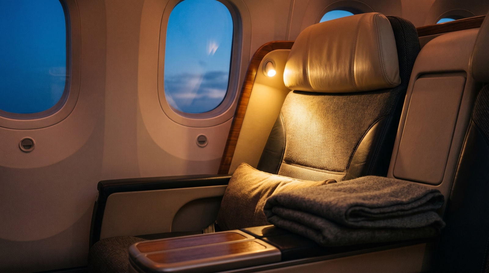
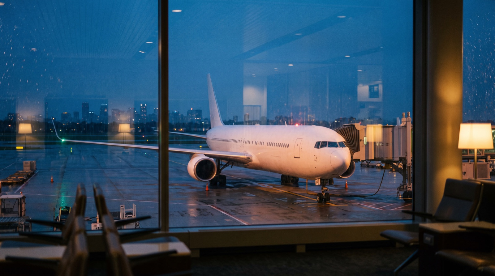

SLUG: citi-thankyou-japan-airlines-transfer-partner
CATEGORY: deals
TITLE: Citi ThankYou to JAL: Why American Is Usually Cheaper
EXCERPT: Citi ThankYou points transfer 1:1 to Japan Airlines. With the 30% bonus over and JAL's surcharge up, the JAL route to a Tokyo business seat saves 5,000 points and costs about $410 more.
META_TITLE: Citi to JAL: Why American Is Usually Cheaper
META_DESCRIPTION: Citi ThankYou points transfer 1:1 to Japan Airlines. What a JAL business seat costs now the bonus is over, the new surcharge, and when to use American.
COVER_ALT: Split cover: a phone on a desk labeled Citi ThankYou points, beside a business class seat labeled JAL Mileage Bank
---BODY---
**Citi ThankYou points transfer to Japan Airlines Mileage Bank at 1:1 on the annual-fee Strata cards, but the 30% launch bonus ended on October 24, 2026, and JAL raised its fuel surcharge on November 1.** The lie-flat seat to Tokyo that looked like a 43,000-point bargain in September now costs the full 55,000 points, plus about $415 in cash per person, each way. The same seat booked through American AAdvantage costs 60,000 points and a few dollars.

## Key takeaways

- The 30% bonus ended on October 24, 2026. A JAL business seat between the US and Japan now costs the full 55,000 JAL miles at the base tier, which is 55,000 points from an annual-fee Strata card.
- JAL's surcharge on a flight from the US rose to $381 for tickets issued from November 1 to December 31, 2026, so a business award runs about $415 per person each way once taxes are added.
- Citi also transfers to American AAdvantage at 1:1, and American does not pass JAL's surcharges on, so the same seat costs 5,000 more points and almost no cash. When American can see the seat, it is the better door.
- JAL's best value is on its partner chart, which prices by total distance, so a round trip can cost less than two one-ways. On JAL's own flights, a round trip is simply double.

Citi added Japan Airlines Mileage Bank as a transfer partner on September 20, 2026, and launched it with a 30% bonus that ran through October 24. Citi says Tokyo is the destination its travel customers book most often internationally, so the partnership makes obvious sense for the bank.

With the bonus over, the useful question for a points holder is not whether this is good news, but which of Citi's two doors to the same JAL cabin you should walk through, because they are priced very differently.

## What Citi actually added

The mechanics are simple, and they depend on which Citi card you hold.

- **Annual-fee cards** (Citi Strata Elite and Strata Premier, plus legacy Prestige and AT&T Access More) transfer at **1:1**. 1,000 points become 1,000 JAL miles.
- **No-annual-fee cards** (Citi Strata, Double Cash, Custom Cash, ThankYou Preferred) transfer at **1:0.7**. Every 1,000 points becomes 700 JAL miles, so these cards lose almost a third of their value on the way.

Transfers move in 1,000-point increments, and the name on your Citi account has to match your JAL Mileage Bank profile. Reports on speed vary from near-instant to a few business days, so treat "instant" as a hope rather than a plan. If you are new to how any of this works, start with our [guide to flying on credit card points](/blog/how-to-fly-for-free-with-credit-card-points), then our [guide to transfer partners](/blog/transfer-partners-explained-guide), which covers the mechanics and the one rule that matters most.

## What a JAL business seat costs in points

At the time of writing, JAL's own award chart for members in the Americas prices a one-way between North America and Japan at 27,000 miles in economy, 40,000 in premium economy and 55,000 in business. From an annual-fee Strata card, that business seat is 55,000 Citi points; during the bonus it was about 43,000. From a no-fee card the same seat needs roughly 79,000 points, which is the number that card's holders should be running.

One caveat that matters more than the arithmetic: 55,000 is the **base** tier, and base-level seats are limited. When those are gone, JAL sells the same cabin through its Award Ticket PLUS tier, where the price climbs as seats get scarce. JAL publishes only a maximum, and that maximum sits far above the base: in the airline's own worked example, a Honolulu economy award runs from 20,000 base miles up to 107,000. Assume PLUS can be a multiple of the base price, not a small premium. The advertised price and the available price are often different numbers, which is the same problem we describe in [phantom award space](/blog/phantom-award-space-why-seats-vanish).

## The surcharge nobody put a number on

Most of the coverage calls JAL's taxes and fees "steep" and moves on. Here is the number.

JAL passes its own carrier-imposed surcharges through on awards flown on JAL metal. For tickets issued from November 1 to December 31, 2026, JAL's surcharge on a flight between the US and Japan is **$381 per person, each way**, up from $320 in October. Add US taxes and a business award comes to about **$415 to $420 per person, each way**. Before the increase, a [NerdWallet writer who actually booked one](https://www.nerdwallet.com/travel/news/citi-thankyou-japan-airlines) in September paid about $360. That is not a tax you can route around; it is the airline's own revenue, collected in cash on top of your miles, exactly as described in our guide to [carrier-imposed surcharges](/blog/avoid-fuel-surcharges-award-flights).

Two things make this harder to plan around. First, the figure moves every two months. Japan's airlines file a new surcharge for each two-month ticketing window, and JAL has said it will publish the level for tickets issued from January 1, 2027 in December. Even the current figure is a subsidized one: JAL says a Japanese government fuel subsidy moved the November and December level down one band, and without it the surcharge on a flight from Japan would be ¥65,000 each way instead of ¥62,000.

Second, older articles still quote figures as low as $142, which was an economy number to begin with and predates the 2026 surcharge increases. Do not plan around it.

## The same JAL seat, two doors

This is the comparison the launch coverage did not make, and it is the whole decision.

Citi transfers to **American AAdvantage** at 1:1 on the same Strata cards. American is a JAL partner, and American does not pass JAL's carrier surcharges through. So the same JAL business seat, on the same aircraft, on the same day, can be bought two ways:

- **Through JAL Mileage Bank:** 55,000 Citi points, plus about $415 in cash.
- **Through American AAdvantage:** about 60,000 Citi points, plus taxes of a few dollars, but only when JAL operates every segment. Add an American connection to the same ticket and AAdvantage reprices it at 80,000, so book a positioning flight separately.

The JAL door saves you 5,000 points and costs you roughly $410 more. Put the other way round, you would be buying those 5,000 points back for about eight cents each, roughly four times what ThankYou points are commonly valued at. Whenever American can see the seat, American is the better buy by a wide margin.

There is one clear exception, and it is the reason to keep JAL miles in mind at all: **availability**. JAL opens its own award space around 360 days before departure, roughly a month before partner programs like American can see it. If JAL has the seat your family needs and American does not, paying the surcharge is a perfectly rational trade. Paying it when American has the same seat is not. Our walkthrough of [booking business class to Tokyo](/blog/business-class-to-tokyo-with-points) maps the rest of the route's options, including ANA.

## Where JAL miles genuinely win

The partnership is more interesting away from the Tokyo nonstop, because JAL prices partner awards on a separate, distance-based chart that adds up the whole itinerary.

That structure has a useful consequence: a round trip is often cheaper than two one-ways, since the distance bands are cumulative. On JAL's own flights the opposite is true, where a round trip is simply double the one-way price. Conflating the two is an easy way to overpay.

The standout is Air France business class from the US, which guides price in the region of 42,000 to 60,000 JAL miles depending on distance, with fees of only a few dollars. That is not because Air France has no surcharges. It has them, and essentially every other program passes them on. JAL is the outlier that does not collect them, which is what makes this worth knowing. Booking that same Air France seat through Flying Blue itself typically costs more miles and several hundred dollars more in cash. British Airways awards are bookable too, but they carry roughly $200 to $250 in surcharges from the US, so they are far less compelling than the mileage price suggests.

JAL also allows generous stopovers on partner awards, which is unusual and genuinely valuable if you want two cities for one redemption.

## Before you move a single point

JAL's program has rules that catch people out, and a transfer is irreversible.

- **The 60-day rule.** JAL restricts redemptions for up to 60 days after you open a Mileage Bank account, not 60 days after your miles arrive. Bilt and Capital One members have been reported to get a seven-day wait instead; as of November 2026 nobody had confirmed the same for Citi. If you are opening a new JMB account to use Citi points, plan on the full 60 days.
- **Miles expire 36 months after they land**, at the end of that month, with no extension and no reinstatement for most members.
- **Awards are for you and close family only**, broadly a spouse and relatives within the second degree. You cannot book a friend, and JAL can ask for proof when surnames differ.
- **Ticketed JAL awards cannot be changed**, only cancelled and rebooked for a fee.

All of which is the long way of saying the same thing we say about every transfer: find and confirm the seat first, then move the points. Never the reverse.

## What the end of the bonus changed

With the bonus, the JAL door was a close call: about 17,000 points saved for about $345 in cash, or roughly two cents a point. Without it, and with the higher surcharge, the case for paying JAL's surcharge narrows to the one it always really had: seats American cannot see yet, or cannot see at all.

That is not a reason to ignore the partnership, just to be honest about what it is: a useful door, occasionally the only open one, and rarely the cheapest. If Citi runs another bonus to JAL, the arithmetic is worth redoing, but the surcharge will still be there.

## Where a specialist comes in

Pricing this properly means holding several moving parts at once: which of your cards transfers at which ratio, whether the base tier or PLUS is what is actually available on your dates, what the surcharge is on the day you book, and whether American can see the same seat for a few dollars in tax.

That is the work we do by hand. A Saver Miles specialist checks both doors for your exact dates, tells you which one to use and what it will really cost in points and cash, and says so plainly when the answer is "book it with American instead". See [how it works](/how-it-works).

## Frequently asked questions

### Is it worth transferring Citi points to Japan Airlines?

It is worth it when you have a specific JAL seat confirmed and JAL's own program is the way to get it, typically because American cannot see that seat. It is not worth transferring speculatively: JAL miles expire 36 months after they land, the transfer cannot be reversed, and since the 30% bonus ended on October 24, 2026, the JAL route to a Tokyo business seat saves only about 5,000 points over American while costing roughly $410 more in cash.

### Do JAL award tickets have fuel surcharges?

Yes, on flights operated by JAL. For tickets issued from November 1 to December 31, 2026, JAL's surcharge on a flight between the US and Japan is $381, so a business award comes to about $415 per person each way with taxes, and JAL resets the figure every two months. Partner awards are different: the surcharge follows the operating airline, so Air France comes in at a few dollars while British Airways runs into the hundreds.

### How long do Citi to JAL transfers take?

Reports range from near-instant to a few business days, and at least one guide cites a worst case of up to 14 days. Because award space can disappear while a transfer is in flight, treat the speed as unpredictable: confirm the seat is bookable first, transfer only what that booking needs, and book as soon as the miles land.

### Can I book a JAL award ticket for a friend?

No. JAL restricts award redemptions to the member and close family, broadly a spouse, including a same-sex partner, and relatives within the second degree of kinship, and it can ask for documentation when surnames differ. If you are booking for anyone outside that circle, this is the wrong program and you should price the trip through a partner instead.

## Start your search

If you are holding Citi points and thinking about Japan, the decision is worth ten minutes of a specialist's time before the transfer, not after. [Start your search](/individual): tell us your dates and what you hold, and we will tell you which door is cheaper, in points and in cash, before anything moves.
